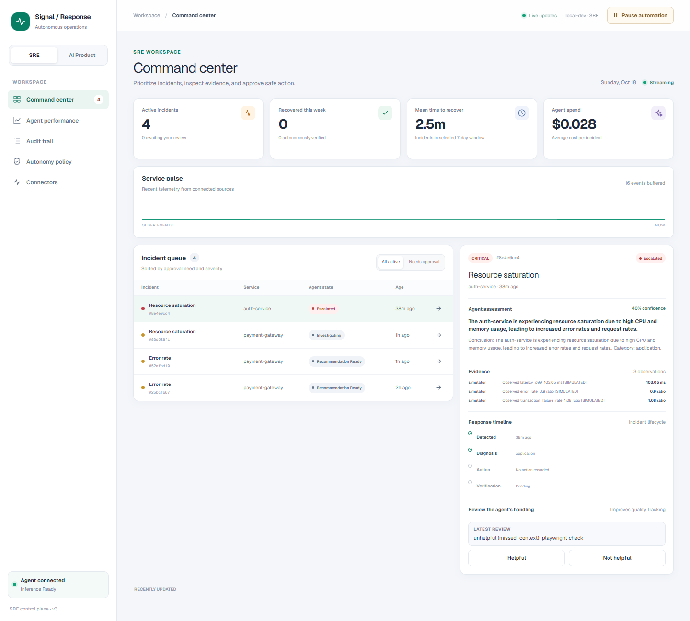
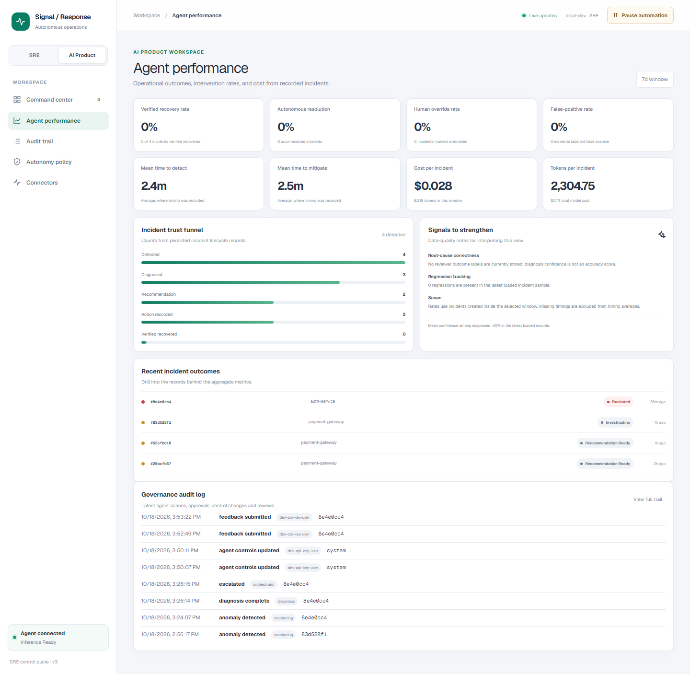
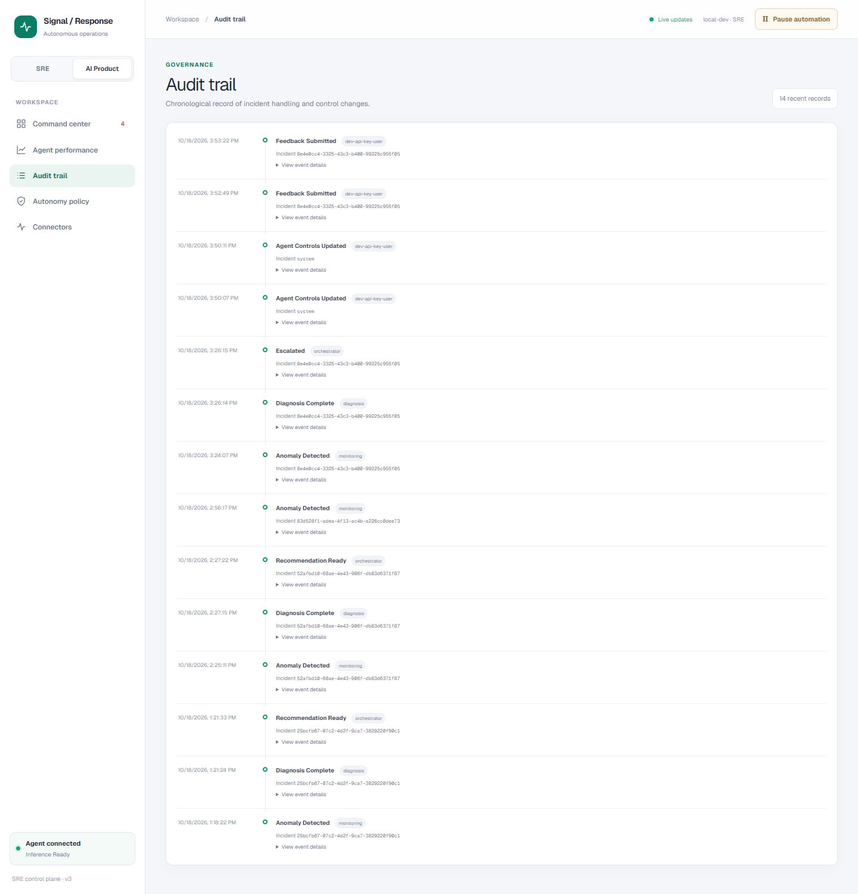
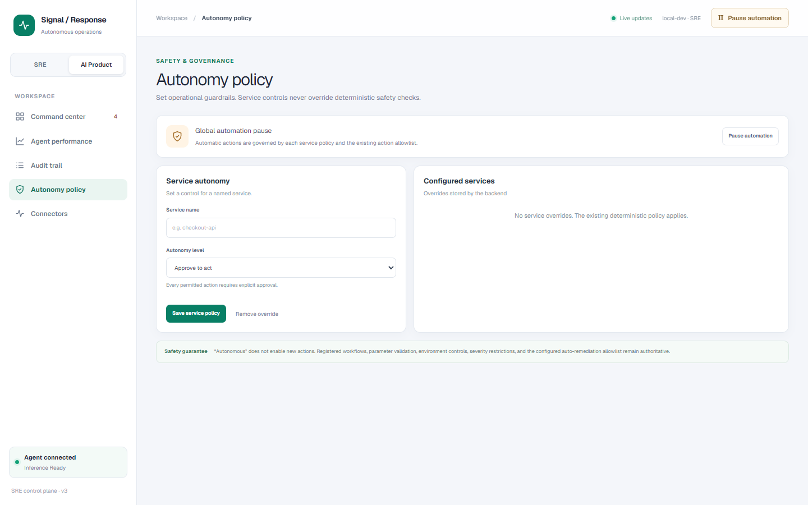
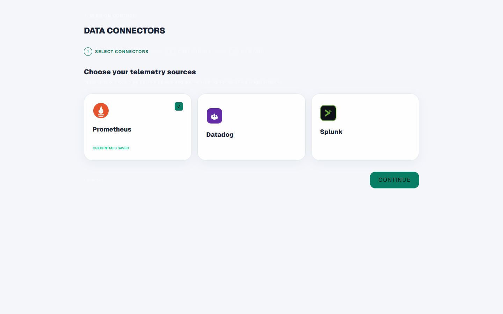

# Sandboxed SRE Intelligence Layer

> An **AI SRE SaaS prototype** built with **LangChain + LangGraph**, a **FastAPI** backend and a **Next.js** dashboard. It ingests observability data and assists with incident diagnosis and response. The current demo runs the API and dashboard locally, stores incident and episodic state in local Docker Postgres, and calls open-weight vLLM models hosted on Modal. Critical events get a root-cause analysis only. Non-critical events are handled by a deterministic policy gate; the demo executors are mocked, so it does not perform live remediation.

> **Deployment status:** this is a controlled local demo, not a production service. Hosted multi-customer operations and tenant isolation are not implemented; do not use it to handle customer or production data. Modal serves the chat, judge and embedding models over public HTTPS endpoints protected by vLLM API keys; it does not host the API or dashboard. Use synthetic alerts and non-sensitive data only. The AWS Terraform is a future private-cloud migration design: it has not been applied, still needs real inputs and quota, and requires reconciliation with the latest Postgres incident-store implementation. See [Demo now, migrate to AWS later](#demo-now-migrate-to-aws-later) and [docs/decisions.md](docs/decisions.md).

## Table of Contents

1. [How it works](#how-it-works)
2. [Components](#components)
3. [Connecting telemetry vendors](#connecting-telemetry-vendors-from-the-dashboard)
4. [Dashboard](#dashboard)
5. [Quick start](#quick-start)
   - [Demo now, migrate to AWS later](#demo-now-migrate-to-aws-later)
6. [Project structure](#project-structure)
7. [API reference](#api-reference)
8. [Testing and evals](#testing-and-evals)
9. [Security](#security)
10. [CI/CD](#cicd)
11. [Known limitations](#known-limitations)

---

## How it works

```
Alert webhook ─► dedupe ─► episodic memory (Postgres): seen this before?
                              │ open/escalated duplicate → suppressed (logged on the original episode)
                              │ resolved+recovered duplicate → stored diagnosis replayed (policy gate still runs)
                              ▼ otherwise
                 Diagnosis graph (local LLM)
                   ├─ procedural memory: skills/<name>/SKILL.md selected by anomaly type, severity, service
                   ├─ specialist experts (database, network, security, application), each with its own RAG
                   │    collection + the shared `policy` collection (company policies, SLAs)
                   └─ evidence-cited hypotheses (confidence capped by real support)
                              ▼
        severity branch ── critical ─► RCA only, no action, escalated to the SRE
                        └─ other ────► allowlisted reversible action (policy-gated, verified) or recommended steps
                              ▼
                 SRE brief (issue, root cause + confidence, fix applied / recommended steps, evidence gaps,
                 duplicate-of, skills used) + per-stage timeline in episodic memory
```

1. **Intake.** `POST /api/v1/alerts/alertmanager` (and `/api/v1/events/process`) turns an alert into an `AnomalyEvent`, deduplicates it, and opens an incident. Local demo auth uses a development API key; the future AWS design uses API Gateway IAM and a trusted identity header.
2. **Memory check.** The fingerprint (sorted services + anomaly type + severity) is looked up in episodic memory within `DUPLICATE_WINDOW_MINUTES`. Duplicates are suppressed, replayed or re-diagnosed depending on how the prior episode ended. A failed prior fix always gets a fresh diagnosis.
3. **Evidence.** `agents/diagnosis/evidence.py` queries the telemetry adapter (Prometheus, Datadog, Splunk, or the simulator for tests) for up to 3 affected services over a 15-minute window, and adds recent GitHub deployments (`GITHUB_DEPLOY_REPO`). Each record carries event time, ingestion time, freshness, `is_simulated` and `source_ref`. A failing source is recorded as an **evidence gap**, never filled with mock data.
4. **Diagnosis.** LangGraph flow: `gather_context` → `rag_runbook_lookup` → `supervisor` (selects experts) → `synthesise_rca`. The model sees evidence with citable ids (E1…En) and the list of unavailable sources, and proposes 2-3 competing hypotheses. `agents/diagnosis/hypotheses.py` resolves citations against the real timeline (invented ids are dropped) and caps confidence (at most 0.4 with no real support, 0.7 with a single supporting record or any contradiction). If the output cannot be parsed, no action is proposed and the incident is escalated.
5. **Policy gate.** Critical incidents are always denied. Non-critical actions are auto-run only if allowlisted and reversible, `AUTO_REMEDIATION_ENABLED=true`, the service is in `AUTO_ACTION_TARGET_SERVICES`, and the hourly limit is not reached. Everything else needs SRE approval or is recommend-only. The demo executors/workflow integration are mocked and do not change infrastructure.
6. **Verification.** `agents/verification/verifier.py` re-reads metrics after the action using only authoritative records (simulated data is excluded). Outcomes are recovered, not recovered, or inconclusive; any adapter error yields inconclusive.
7. **Close-out.** PagerDuty and Slack updates, the incident store (hypotheses, queries, approvals), and the episodic-memory outcome plus SRE brief.

## Components

| Piece | Where | Notes |
|-------|-------|-------|
| Procedural memory | `skills/<name>/SKILL.md`, `shared/skills.py` | Agent-skills format: `name` and `description` front matter, with routing under `metadata` (`triggers`: anomaly_types, severities, services; `priority`; `version`). `baseline-conduct` always applies; `critical-rca-only` applies to critical. Edit files, no code change. |
| Per-agent RAG | `knowledge_base/`, `agents/diagnosis/experts.py` | `documents.collection` column. Ingest `<root>/<collection>/*.md` with `ingest_directory` (collections: `database`, `network`, `security`, `application`, `policy`). Hybrid vector + keyword search with reciprocal-rank fusion. Retrieval failure is recorded as a gap. |
| Episodic memory | `shared/episodic_memory.py`, `knowledge_base/migrations/003_episodic_memory.sql` | Postgres; falls back to in-process memory with a loud log (`episodic_memory_degraded` in `/api/v1/status`) if unreachable. |
| Action harness | `agents/action/policy.py`, `agents/action/tiers.py` | Deterministic policy; tiers: 1 reversible, 2 needs approval, 3 always human. The auto allowlist can only narrow the reversible set. |
| Egress harness | `shared/egress.py`, `infra/aws/terraform` | App-level fail-closed allowlist (private ranges + `EGRESS_ALLOWED_HOSTS` / `EGRESS_ALLOWED_CIDRS`) on the LLM client and every HTTP client, with a startup self-test. The VPC (no internet/NAT gateway, no `0.0.0.0/0` security-group rule) is the network-level backstop. |
| Local models | `shared/llm.py` | OpenAI-compatible vLLM server (`LLM_BASE_URL`, `LLM_API_KEY`). Embeddings via `EMBEDDING_*`. The judge has its own `JUDGE_BASE_URL`. |
| Monitoring | `agents/monitoring/` | Anomaly detection for the telemetry stream path. |
| Verification | `agents/verification/` | Independent post-action recovery check. |
| Regression detector | `agents/feedback/regression.py` | Flags earlier fixes that did not hold. Also provides `alert_key` for dedupe. |

Inter-agent contracts are Pydantic v2 models in `shared/schemas.py`: `TelemetryEvent`, `AnomalyEvent`, `DiagnosisResult`, `ActionResult`, `IncidentRecord`.

**AWS sandbox target:** the design calls for chat and embedding models inside a private VPC and `LLM_BASE_URL` pointed at that server; apply the SQL migrations (changing `EMBEDDING_DIMENSIONS` requires re-embedding); ingest runbooks, policies and SLAs per collection; then reconcile and deploy `infra/aws/terraform` for the network-level boundary. This has not been deployed. SaaS vendors (Datadog, PagerDuty, Slack, GitHub) are blocked by default: route them privately or add them to `EGRESS_ALLOWED_HOSTS`.

## Connecting telemetry vendors from the dashboard

Open `/connectors` in the dashboard:

1. **Select** one or more connectors (Prometheus, Datadog, Splunk) as icon cards.
2. **Credentials**: fill in and "Test connection" for each. Saved secrets are never returned by the API (shown as "saved").
3. **Activate**: choose services, dry-run and poll interval. The selection builds `CONNECTOR_MODES` at runtime and starts combined live ingestion (`/api/v1/connectors*`, `/api/v1/ingestion/status`). Missing credentials do not crash startup; ingestion just stays inactive.

State is persisted to `.connector_state.json` (gitignored, **plaintext secrets**; use a secret manager in production) and overrides `CONNECTOR_MODES` from `.env`. Dashboard env: `NEXT_PUBLIC_API_BASE` (default `http://localhost:8050/api/v1`; use `:8010` with `make api`) and `NEXT_PUBLIC_API_KEY` (sent as `X-API-Key`). Default query templates are assumptions; override with `TELEMETRY_QUERY_TEMPLATES`. Not yet validated against live vendors.

## Dashboard

| Component | Data source |
|-----------|-------------|
| System pulse (telemetry scatter) | `GET /api/v1/telemetry/recent` |
| Active response workflows (incident lifecycle) | `GET /api/v1/incidents/active` |
| Status cards (active, resolved, episodic-memory health) | `GET /api/v1/status` |
| Connection status | `GET /api/v1/health/detailed` |
| Connector wizard | `/api/v1/connectors*` |

```bash
# Terminal 1: backend (port 8010; set NEXT_PUBLIC_API_BASE to http://localhost:8010/api/v1)
make api

# Terminal 2: dashboard (http://localhost:3000)
cd dashboard
npm install
npm run dev
```

### Screenshots

Full-page captures of the light-theme dashboard (1440px wide, local dev data).

**Command center (SRE triage, incident detail with feedback control)**



**Agent performance (AI product view with governance audit log)**



**Audit trail**



**Autonomy policy**



**Data connectors**



## Quick start

Prerequisites: Python 3.11+, Docker Desktop, Node.js 18+, and an OpenAI-compatible inference server (vLLM) reachable from the app. Without a local GPU, use the Modal dev servers below.

```bash
pip install poetry
poetry install
copy .env.example .env        # set the LLM_*, EMBEDDING_*, JUDGE_* and EGRESS_* values (see below)
docker compose up -d postgres prometheus   # migrations in knowledge_base/migrations run on first start
poetry run python -c "import asyncio; from knowledge_base.ingestion.pipeline import RunbookIngestionPipeline; asyncio.run(RunbookIngestionPipeline().ingest_sample_runbooks())"
make api                      # API on http://127.0.0.1:8010
make demo                     # fires a critical sample alert; `make demo-warning` fires a non-critical one
poetry run pytest tests/unit tests/evals -q
```

Local auth: with `APP_ENV=development` set `REQUIRE_GATEWAY_AUTH=false` and `API_AUTH_TOKEN=<token>`, and send it as `X-API-Key`. In any other environment requests must carry the API Gateway identity header.

### Dev inference on Modal (vLLM)

`infra/modal/vllm_app.py` deploys API-key-protected vLLM endpoints: chat (`qwen2.5-7b-instruct`, L4), judge (`llama-3.1-8b-instruct`, L4), embeddings (`bge-base-en-v1.5`, T4, 768 dimensions), and an offline-only Mistral-Small-24B labeller (A100-80GB) for clearly marked simulated evaluation labels. Deploying defines the endpoints; GPU workers start on requests and scale down after idle windows, but active GPU time is billable.

```bash
modal secret create vllm-api-key VLLM_API_KEY=<long-random-string>
make modal-deploy     # prints the four endpoint URLs (labeller is for offline simulated labels only)
make modal-stop       # stop GPU spend when finished (the CLI asks for confirmation; add --yes to skip)
```

Set in `.env`: `LLM_BASE_URL`, `LLM_API_KEY`, `EMBEDDING_BASE_URL`, `EMBEDDING_MODEL`, `EMBEDDING_DIMENSIONS=768`, the model names (`DEFAULT_MODEL` and the `*_AGENT_MODEL` values), `JUDGE_MODEL`, `JUDGE_BASE_URL`, `JUDGE_API_KEY`, and `EGRESS_ALLOWED_HOSTS=*.modal.run`. Modal endpoints are public HTTPS services even though vLLM requires the API key. Do not send production/customer telemetry, secrets, or personal data to this demo. The first request can cold-start a GPU and may briefly return a redirect or unavailable response until the model loads.

The dashboard polls `/api/v1/health/detailed` for chat and embedding model readiness. While a Modal worker is cold-starting, it shows an indeterminate loading bar and keeps **Synthesize Anomaly** disabled; it enables the demo after both endpoints report ready. Startup time varies, so the bar intentionally does not imply a percentage or fixed ETA.

### Demo now, migrate to AWS later

**Demo path (today):**

1. Deploy the Modal model endpoints and configure their URLs and API keys in the local `.env`.
2. Start local Postgres and Prometheus with `docker compose up -d postgres prometheus`; Postgres runs the mounted SQL migrations on first initialization. The incident, approval, audit and episodic stores use Postgres by default.
3. Start the API with `make api` (port 8010) and the dashboard from `dashboard` with `npm run dev -- -p 3010`. For local dashboard calls, set `CORS_EXTRA_ORIGINS=http://localhost:3010`, `NEXT_PUBLIC_API_BASE=http://localhost:8010/api/v1` and `NEXT_PUBLIC_API_KEY` to the development API token before starting/building Next.js.
4. Use `make demo` or `make demo-warning` to show a synthetic investigation. Remediation executors are mocked; no live infrastructure changes occur.
5. Stop Modal when finished with `make modal-stop`. This stops GPU work; local API, dashboard and Docker services are managed separately.

This setup is suitable for a controlled walkthrough, not a production launch: the API/dashboard are local, the model endpoints are public, local development auth is not production identity, connector state may contain plaintext credentials, and live vendor integrations/remediation have not been validated.

**Later AWS migration stages:**

1. **Close readiness gaps:** decide the production data boundary, threat model, authentication/authorization, retention, budgets and incident response; review the action executors and SRE skills; validate telemetry connectors and production-sized tests.
2. **Prepare AWS prerequisites:** choose a region and budget, request adequate GPU quota, create the GitHub Actions OIDC provider, select a compatible GPU AMI, create the private model bucket and Secrets Manager secrets, and build/push the inference image and model artifacts. Never put secret values in `terraform.tfvars`.
3. **Reconcile Terraform with current code:** review `infra/aws/terraform` against Postgres-backed incidents and current environment/configuration. In particular, verify whether the existing EFS resources and task permissions are still needed; the deployment guide's former EFS/SQLite assumptions are obsolete. Configure encrypted remote Terraform state and locking.
4. **Plan before applying:** populate ignored `terraform.tfvars`, validate the AWS account and caller CIDRs, run `terraform fmt -check`, `terraform validate`, and `terraform plan`, then review resource changes and costs. Apply only after explicit approval.
5. **Move serving private:** deploy chat and embedding vLLM in the private VPC; point `LLM_BASE_URL` and `EMBEDDING_BASE_URL` at those endpoints, provision an independent judge endpoint, and verify egress, API key delivery, logs and model loading without public model egress.
6. **Deploy and verify the product surface:** deploy the API behind the private API Gateway integration, choose and secure a dashboard hosting path (not currently provided by the Terraform), migrate database contents, apply migrations, verify authenticated routes and recovery/approval behavior, then run load, failure, backup/restore and security tests before enabling production traffic.

The AWS guide is a design/runbook, not evidence of a successful AWS deployment. See [AWS deployment and security guide](docs/DEPLOYMENT_SECURITY.md).

## Project structure

```
├── agents/
│   ├── monitoring/          # anomaly detection + tools
│   ├── diagnosis/           # LangGraph supervisor-expert graph, per-expert RAG, hypotheses, evidence
│   ├── action/              # policy gate, tiers, workflows, PagerDuty, Slack
│   ├── verification/        # independent recovery check
│   └── feedback/            # regression detector (alert_key)
├── skills/                  # procedural memory (<name>/SKILL.md)
├── knowledge_base/          # ingestion, hybrid retrieval, migrations (pgvector, episodic memory)
├── shared/                  # config, schemas, llm, egress, skills, episodic_memory, incident_store, pii
├── data_pipeline/           # telemetry adapters, Alertmanager intake, deploy events, connector store
├── dashboard/               # Next.js SRE UI (incl. /connectors)
├── evals/                   # LLM-as-judge, agreement gate (local judge model)
├── tests/                   # unit, integration, evals
├── infra/                   # aws/terraform (VPC, ECS agent, EC2 GPU server with chat+embedding vLLM, RDS), modal/ (dev vLLM), docker/Dockerfile
├── scripts/                 # sample alert sender, chaos experiments, verification and seeding helpers
├── orchestrator.py          # severity-branched pipeline
├── api.py                   # FastAPI app
└── docs/                    # deployment and design documents
```

## API reference

| Method | Endpoint | Description |
|--------|----------|-------------|
| `GET` | `/health` | Health check |
| `GET` | `/api/v1/health/detailed` | Health with agent connectivity |
| `POST` | `/api/v1/alerts/alertmanager` | Alertmanager webhook intake |
| `POST` | `/api/v1/events/process` | Process a single telemetry event |
| `POST` | `/api/v1/demo/run` | Demo with synthetic events |
| `POST` | `/api/v1/stream/start` | Streaming simulation |
| `GET` | `/api/v1/telemetry/recent` | Last 100 telemetry events |
| `GET` | `/api/v1/incidents` | Recent incidents (status filter) |
| `GET` | `/api/v1/incidents/active` | Active incidents |
| `GET` | `/api/v1/incidents/{id}` | Incident details |
| `GET` | `/api/v1/incidents/{id}/brief` | SRE brief for an incident |
| `POST` | `/api/v1/incidents/{id}/approve` | Approve or reject a pending action |
| `GET` | `/api/v1/episodes/{id}` | Episodic-memory episode and timeline |
| `GET` | `/api/v1/status` | System status |
| `GET` | `/api/v1/actions/tiers` | Action tier reference |
| `POST` | `/api/v1/knowledge/seed` | Ingest sample runbooks |
| `GET` | `/api/v1/knowledge/search` | Hybrid RAG search |
| `GET` | `/api/v1/knowledge/health` | Knowledge base connectivity |
| `GET/POST` | `/api/v1/connectors*`, `/api/v1/ingestion/status` | Connector wizard and live ingestion |

## Testing and evals

```bash
poetry run pytest tests/ -v                 # everything
poetry run pytest tests/unit -v             # unit tests
poetry run ruff check .                     # lint
poetry run python scripts/run_chaos_experiments.py
make judge-sanity                           # live judge over the golden cases, no human labels needed
make judge-gate                             # judge-vs-human agreement gate, needs 30+ human labels
make simulate-labels BASE_URL=<labeller>/v1 # AI-simulated labels (NOT human) from a Mistral-24B Modal function
poetry run python -m evals.adjudicate_simulated_labels # separate, provenance-preserving machine-constrained copy
make judge-gate-simulated                   # judge vs those simulated labels: model-vs-model, not a human gate
```

The judge calls its own server (`JUDGE_BASE_URL`, falling back to `LLM_BASE_URL`) with `JUDGE_MODEL`, and must come from a different provider than every agent model. `evals/provider_check.py` checks this deterministically from model names (unknown models fail; declare them with `MODEL_PROVIDER_MAP`). `local_judge_fn` refuses to run on a clash, and the judge entry points prompt you to pick another provider (exit code 3 when non-interactive).

`make judge-sanity` (`evals/judge_sanity.py`) checks that the judge follows the rubric: valid JSON for every case and clean cases scoring at least 1.0 above deterministically flawed ones. On the 32 golden cases with Llama-3.1-8B it passed (clean mean 4.28, flawed mean 2.86), but it rated four flawed cases 5/5 (tier understated, tier 3 executed autonomously, `DROP TABLE`, SSN in the root cause). That is why the deterministic policy and PII layers, not the judge, are the safety gate. This is not the human-agreement gate: `evals/data/human_labels.jsonl` is still empty, so re-baseline with human labels before trusting scores. The golden dataset test checks dataset integrity only; retrieval quality must be measured against the live knowledge base once it is ingested.

`evals/machine_reward.py` defines a first machine-checkable reward prototype for future judge training. It validates judge response format and checks whether ratings reflect deterministic action/tier/execution violations, destructive, prompt-injection-compliant or unauthorized-execution output, citation/required-tool gaps, and detected overconfidence. `poetry run python -m evals.adjudicate_simulated_labels` applies only downward score caps for detected contradictions and writes `evals/data/machine_adjudicated_labels.jsonl`, preserving original scores and rationales alongside adjusted scores and detector evidence. It does not raise scores just because a detector found no issue. The output has no fully verified rubric dimensions: diagnostic accuracy and every unconstrained simulated rating remain unverified, and privacy/secret-leak findings remain explicitly unscored because the rubric has no confidentiality dimension. Tool-call policy violations are reported but are not relabeled as action safety. Use this derived data only as weak supervision for enforcing the checked constraints, not as a quality benchmark or proof that an incident response is good. No training loop consumes it yet; any trained judge still needs blind evaluation against SRE labels, and deterministic safety controls remain authoritative.

The specialist-routing pilot uses provisional, web-researched labels in `evals/data/specialist_routing_labels.json`; labels use only the incident issue and evidence visible to the supervisor, not the downstream agent output. These are not SRE ground truth and must be reviewed before they are used as a promotion gate. Run `poetry run python -m evals.run_specialist_routing` against the configured diagnosis model, then `poetry run python -m evals.measure_specialist_routing` to report per-expert and micro precision/recall, missed-required-expert rate, unnecessary dispatches, and exact-set accuracy. The evaluator counts the implementation's application-expert fallback for malformed, empty, or unrecognized routing output.

Specialist report and synthesis evaluation is implemented in `evals/run_specialist_quality.py`. The diagnosis graph passes the same gathered context, evidence timeline, and graph-level runbook results to every dispatched specialist; reports retain incident/evidence/runbook provenance through synthesis. Run `poetry run python -m evals.run_specialist_quality --phase reports` to snapshot the golden incident packets and retrieved runbooks, run all four specialist roles per case, and score relevance, evidence support, unsupported claims, useful evidence gaps, and a subjective confidence-alignment proxy with the independently configured judge. Then run `poetry run python -m evals.run_specialist_quality --phase synthesis` for controlled comparisons with reports omitted, relevant reports, one irrelevant report, and relevant reports plus a report from another incident. Add `--limit N` for a small pilot. Synthesis generation and assessment are checkpointed; reruns reuse results only when their prompt hashes match. The synthesis judge uses a 512-token completion budget to fit the configured context window. These evaluations use static golden evidence (not live telemetry), provisional non-SRE labels, and a fallible LLM reviewer. The specialists' fixed `0.75` confidence is not statistically calibratable without incident outcomes. Synthesis judge scores are stored separately from deterministic action-tier, case-allowlist, citation, and blocking-guardrail checks; they do not authorize or override actions.

## Security

| Method | Environment | Details |
|--------|-------------|---------|
| `.env` file | Local development | Loaded via `pydantic-settings` |
| AWS Secrets Manager | ECS/Fargate pilot | ECS injects configured secret ARNs at startup |
| GitHub OIDC | CI deployment | Short-lived AWS role session, no stored access key |
| AWS IAM task role | ECS task | Scoped to the task's EFS access point |

The future AWS design uses SigV4 with API Gateway `AWS_IAM` authorization and a private VPC endpoint; that deployment is not live. The current API is local and uses development authentication. See the [future AWS deployment and security design](docs/DEPLOYMENT_SECURITY.md).

Network posture: the application HTTP client has a fail-closed egress allowlist (`shared/egress.py`); the VPC security-group restrictions in `infra/aws/terraform` are a future deployment design, not active protection for Modal. Tracing goes to the local self-hosted Langfuse (`LANGFUSE_BASE_URL=http://localhost:3001`, keys from its UI). Hosted LangSmith is forced off at startup unless its endpoint passes the egress check, and a Langfuse host that fails the check gets no handler (tracing is skipped, not sent). `event_id` ties the Langfuse session, the logs and the incident together; API requests are traced with OpenTelemetry, exported only to an egress-allowed collector set in `OTEL_EXPORTER_OTLP_ENDPOINT` (empty by default). See [decisions 4.5](docs/decisions.md). Optional integrations (Slack, PagerDuty, GitHub, n8n) are only reachable if explicitly allowlisted.

## CI/CD

GitHub Actions runs lint, tests and a Docker build on pull requests. The workflow has a gated AWS ECS/Fargate deployment job on pushes to `main` using GitHub OIDC, but it runs only when the repository variable `AWS_DEPLOY_ENABLED=true` and a provisioned AWS target is configured; this repository has not deployed that target. Pull requests receive no AWS credentials. Stages: `ruff` → `pytest` → build and push to ECR → force ECS deployment and wait for stability.

## Known limitations

| Area | Limitation |
|------|-----------|
| Validation | Unit-tested (310 tests). Run end to end locally on a critical alert and a warning alert (recommend path, tier 3, nothing auto-executed) with Modal-hosted vLLM, Postgres and sample runbooks. Not run for the auto-fix path (executors are mocked), against live vendors, or on AWS. |
| Open-weight models | Weaker at structured output than hosted frontier models; the hypothesis validation and "no action if unparseable" rule are the safety net. Dev uses 7-8B models, so expect thin root causes. |
| Judge | The judge is a small model that misses some flaws (see Testing); the human-agreement gate has no labels yet. In production no judge server exists in the Terraform; it needs its own container or instance. |
| Incident store | Postgres by default (`PostgresIncidentStore`, tables `incident_records` and `incident_audit_trail`); `INCIDENT_STORE_BACKEND=sqlite` keeps the local file store. A reachable database is required. |
| Infra | Terraform validates but has not been applied. You must raise the GPU quota, mirror the vLLM image into ECR, upload model weights to S3 and run the DB migrations (via ECS Exec). The LLM server is a single instance, and the GPU layout assumes a 70B AWQ model, which fits tightly. |
| Alert intake | Alertmanager cannot sign AWS IAM requests, so a gateway that injects the trusted identity header is required; diagnosis runs inside the webhook request; dedupe key is `service:anomaly_type`; anomaly type is a keyword guess; no PagerDuty intake. |
| Evidence window | Fixed 15-minute window, not anchored on the alert start; metrics and deploys only; the GitHub deploy repo is global, not per service. |
| Confidence | Hypothesis caps (0.4 / 0.7) are heuristics, not calibrated; the policy gate does not read hypothesis confidence. |
| Dashboard | Overview and connector pages work; Observability/KB/Security nav entries are placeholders. Some overview cards and incident stage indicators are presentation-only (for example, the displayed uptime/node count and `+12% from yesterday`); do not present those as measured production SLOs or real completed actions. |
| Open audit items | `trigger_workflow` returns `mocked` without `N8N_API_KEY`; the Slack summary LLM call is unguarded; the dashboard shows a hardcoded "+12% from yesterday" under Autonomously Resolved. GET endpoints now require auth. The `.env` in a dev checkout may hold old provider keys; rotate and remove them. |

## License

Private — Internal Use Only
