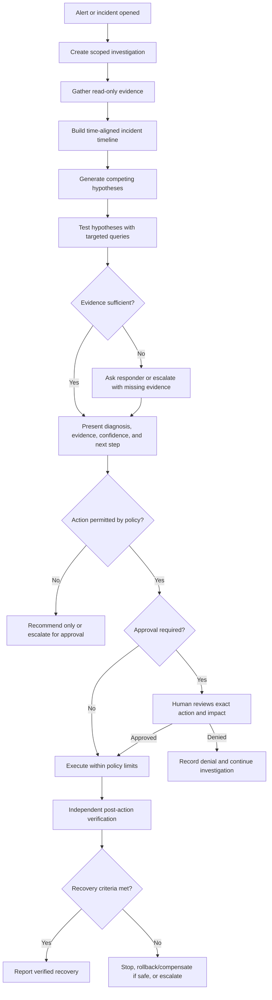
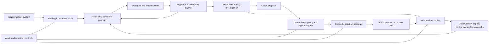

# SRE Agent Product Strategy Blueprint

## Purpose

This document extends the existing [SRE Strategic Blueprint](./SRE_STRATEGIC_BLUEPRINT.md) with a product direction centered on trustworthy incident investigation, controlled remediation, and independent verification.

The direction is informed in part by a user-collected summary of Reddit discussions. Treat those discussions as anecdotal signals and hypotheses, not representative industry research. The summary includes some non-Reddit references and assertions that have not been independently validated. Validate product choices through direct conversations with SREs and incident replay before treating them as requirements.

## 1. Product thesis

Build an **incident investigation and response system** that helps responders collect relevant evidence, test plausible causes, choose a bounded next step, and verify recovery.

> We assemble the evidence, test likely causes, recommend a bounded response, and independently check whether it worked.

Do not lead with a promise of a fully autonomous SRE. Begin with read-only investigation and guided response. Earn permission for production execution through transparent evidence, explicit policy, and reliable verification.

### Product principles

1. **Evidence before conclusions:** Every diagnosis should be traceable to time-stamped signals and source systems.
2. **Uncertainty is a valid outcome:** The system can report that evidence is insufficient or contradictory and ask for human input.
3. **Policy, not model judgment, grants authority:** A model may propose a tool call; deterministic controls decide whether it is permitted.
4. **Action completion is not incident recovery:** Verify the service independently after any mitigation.
5. **Use customer context deliberately:** Runbooks, ownership, deployment history, dependencies, and incident history should inform investigation, with provenance.
6. **Minimize retained sensitive data:** Keep only what is necessary for operations, audit, and evaluation, under configurable retention controls.

## 2. Target workflow

The agent should preserve an incident thread containing the evidence gathered, hypotheses considered, queries performed, action proposals, approvals, execution results, and verification outcome.

## 3. Investigation and evidence model

### 3.1 Investigation starts from an incident

Prefer event-triggered investigation from an alert or incident over broad, continuous polling of every telemetry source. Query only the relevant services, time windows, and signals needed to answer the current investigative question. Respect connector quotas, data freshness, and source-specific query limits.

### 3.2 Build a timeline before asserting a cause

Correlate relevant events on a common timeline, including as available:

- User-impact indicators and service-level objectives.
- Metrics, logs, traces, and health checks.
- Deployments, configuration changes, and infrastructure events.
- Dependency and ownership information.
- Runbook steps and relevant prior incident findings.

### 3.3 Represent hypotheses explicitly

For each candidate cause, record:

- A concise hypothesis and affected service/resource scope.
- Supporting and contradicting observations.
- Evidence source, query or link, observation time, event time, and freshness.
- Missing data or limitations.
- Confidence as a calibrated estimate or qualitative band, not false precision.
- The next safe query or human question that could distinguish it from alternatives.

Do not imply that a correlation proves causation. The system should state when telemetry is stale, unavailable, sampled, or contradictory.

### 3.4 Normalize evidence without erasing provenance

Continue using vendor adapters and normalized internal representations, but retain source identity and semantics. A normalized record should include, as applicable:

- `observed_at` and event timestamp, including timezone.
- Source system, source object/query reference, and connector version.
- Service, environment, resource identifiers, and relevant tags.
- Signal type, name, value or bounded excerpt, unit, and quality/freshness.
- Access classification and retention category.

Normalization must not claim that vendor-specific anomaly scores or severity fields are equivalent across vendors. Preserve the original value and source meaning where mappings are approximate.

## 4. Architecture and trust boundaries

Keep pluggable telemetry connectors, but organize the system around separate investigation, decision, execution, and verification responsibilities.

### Components

1. **Incident intake:** Receives an alert or incident, resolves service ownership, and creates a bounded investigation context.
2. **Read-only connector gateway:** Executes allowlisted queries using least-privilege, scoped credentials. It handles timeouts, rate limits, and source errors explicitly.
3. **Evidence and timeline layer:** Holds short-lived investigation data and durable references or summaries according to customer policy.
4. **Investigation orchestrator:** Plans targeted queries, compares hypotheses, and prepares a responder-readable report.
5. **Action policy gate:** Applies deterministic authorization, preconditions, scope limits, approval requirements, cooldowns, and concurrency controls before any write operation.
6. **Execution gateway:** Exposes a small catalog of typed, allowlisted operations rather than arbitrary shell or unrestricted API access.
7. **Independent verifier:** Checks service-level outcomes using signals that are separate from the action's execution acknowledgement.
8. **Audit and retention layer:** Records decisions and actions with integrity protection and access controls, without defaulting to storing raw telemetry or private model reasoning.

Diagnosis and execution credentials must remain separate. The model must never receive ambient write credentials or be able to bypass the policy gate.

## 5. Graduated autonomy and action safety

Configure autonomy per action, service, environment, and response plan—not as one global “autonomous” switch.

| Stage | Behavior | Appropriate starting point |
|---|---|---|
| 0. Observe | Read-only investigation and evidence gathering | Initial pilots |
| 1. Recommend | Explain a proposed action; responder executes it manually | Initial production use |
| 2. Approve | Prepare a typed action; an authorized human approves the exact target and parameters | Early controlled automation |
| 3. Bounded automation | Execute allowlisted low-risk actions only when deterministic preconditions pass | Later, after replay and supervised evidence |
| 4. Expanded automation | Broaden action scope only through explicit policy changes and evaluation | Not an MVP assumption |

Every executable action needs:

- Explicitly authorized action type, target scope, and environment.
- Preconditions checked against current state immediately before execution.
- A preview of expected impact, affected resources, and relevant recent changes.
- Policy-defined approval and identity requirements.
- Idempotency or duplicate-execution protection where possible.
- Rate limits, cooldowns, concurrency limits, and blast-radius caps.
- A timeout and a clear stop condition.
- A documented rollback or compensating action where one is safe and feasible.
- An audit record and independent verification plan.

High-impact, irreversible, poorly understood, or weakly supported actions remain human-controlled. A guardrail rejection or connector failure must be visible; it must not be silently treated as success or as permission to try a broader action.

## 6. Independent verification and recovery

Verification is a first-class subsystem, not a success message generated by the executor.

### Verification contract

Each action should declare before execution:

- The expected service-level outcome.
- The signals and authoritative sources used to assess it.
- Thresholds or qualitative criteria, evaluation window, and freshness requirements.
- Stop or abort criteria for worsening user impact.
- What to do if checks are inconclusive or unavailable.
- Whether a rollback or compensating action is safe.

After execution, the verifier should:

1. Confirm the operation's execution status and affected scope.
2. Wait for the configured stabilization period.
3. Query independent health checks and service-level indicators.
4. Compare results with the pre-action state and recovery criteria.
5. Report **verified recovery**, **not recovered**, or **inconclusive**—never collapse these into a generic “success.”
6. Stop further automated actions and escalate when the result is harmful, uncertain, or outside policy.

Where practical, verify user-visible behavior (for example, a synthetic journey or health endpoint) as well as infrastructure state. A healthy process or successful API response alone does not establish that users have recovered.

## 7. Data handling, privacy, and auditability

Replace absolute claims such as “zero data duplication” with a precise, configurable data-handling statement. On-demand access can avoid building a second telemetry warehouse, but query results may still pass through the product, model provider, logs, and connected incident systems.

Define and document:

- Which fields are read, transformed, sent to any model, displayed, and retained.
- Redaction and exclusion rules for secrets, personal data, and sensitive payloads.
- Whether model processing is customer-controlled, provider-hosted, or configurable.
- Short-lived evidence-cache behavior and retention/deletion controls.
- Audit-log contents, access controls, integrity guarantees, and retention period.
- Connector credential storage, scope, rotation, and revocation.
- Failure behavior when a source is unavailable or a retention rule blocks access.

Audit records should capture timestamps, actor/agent identity, evidence references, policy decision, action parameters, approval, execution result, and verification outcome. Do not make retention of raw telemetry or private chain-of-thought a default audit requirement. Provide concise decision summaries and source references instead.

## 8. Evaluation before autonomy

Do not use MTTR or human acceptance alone as a learning reward. These are confounded outcomes: an incident can recover for unrelated reasons, and an accepted recommendation is not necessarily correct or safe.

Build an evaluation loop in this order:

1. **Curated scenarios:** Include known causes, misleading signals, missing telemetry, conflicting evidence, and failed mitigations.
2. **Historical incident replay:** Replay sanitized, permissioned incidents and compare the investigation with confirmed findings and actual timelines.
3. **Human review:** Capture corrections, missing context, rejected hypotheses, and unsafe or irrelevant recommendations.
4. **Offline policy evaluation:** Measure performance on a frozen dataset before changing live behavior.
5. **Shadow mode:** Run investigations without executing actions and compare with responder decisions.
6. **Supervised pilot:** Enable approval-required actions for a narrow allowlist and monitor verification results.
7. **Bounded automation:** Permit automatic execution only when the action, preconditions, and recovery checks have demonstrated acceptable performance.

Any later adaptive policy should have versioning, offline evaluation, a controlled rollout, a kill switch, and a rollback path. Learned behavior must never override deterministic authorization and safety policy.

## 9. MVP recommendation

Validate the target incident class with SRE interviews before committing to it. A deployment-related degradation is a useful candidate for a prototype because deployment events, service indicators, and a rollback decision can be evaluated, but it is not yet a validated market priority.

### Candidate MVP workflow

1. Receive an alert for one service and environment.
2. Fetch a narrow time window of service-level indicators, a small relevant log sample, and recent deployment events.
3. Build a timestamped timeline with source links and freshness.
4. Compare a deployment-related hypothesis with at least one plausible alternative.
5. Show supporting evidence, contradictions, uncertainty, and missing data.
6. Recommend a documented rollback or other runbook step; require a responder to approve or perform it.
7. Independently check user-facing health and relevant SLO signals after the action.
8. Escalate with a clear diagnosis and evidence if verification fails or is inconclusive.

Start with one or two high-value integrations selected through customer discovery rather than promising broad connector coverage. Keep the simulator for repeatable demos and regression tests.

### MVP exclusions

- Unrestricted shell execution or arbitrary infrastructure writes.
- Automatic database, security, network, or irreversible changes.
- A general-purpose “fix any incident” promise.
- Continuous broad polling across all customer telemetry.
- Online reinforcement learning that changes action policy based on production outcomes.
- Retention of raw telemetry or private chain-of-thought by default.

## 10. Success measures

Measure investigation quality, safety, and recovery—not only response speed.

### Investigation

- Time from alert to first useful, evidence-linked assessment.
- Responder-rated usefulness of the timeline and hypotheses.
- Rate of diagnoses supported by confirmed evidence.
- Ability to identify missing, stale, or contradictory evidence.
- Query volume, connector latency, and source/API failure rate.

### Action safety

- Recommendation acceptance, modification, and rejection rates with reasons.
- Policy denials and approval outcomes.
- Incorrect-target, duplicate-action, and out-of-scope action rate.
- Automated stop and escalation correctness.

### Verification and operations

- Rate of actions with conclusive independent verification.
- Verified recovery rate within the defined evaluation window.
- Rate of harmful or inconclusive actions detected and escalated.
- Time to verified recovery, reported alongside incident severity and context.
- Human overrides and subsequent outcomes.

Define measurement windows and baselines with pilot customers. Do not market a measured MTTR reduction from a small, uncontrolled sample as a causal product result.

## 11. Customer discovery

Use public posts and postmortems to generate hypotheses, not to claim industry-wide consensus. The Reddit summary that informed this document is a starting point only; validate findings against original sources and direct interviews.

Ask SREs to walk through recent incidents rather than asking whether they want an “AI SRE”:

1. Walk me through a recent incident from alert to recovery. What did you inspect, and in what order?
2. Which part took the longest, and what made it difficult?
3. What action did you consider but hesitate to take? What evidence or approval did you need?
4. How did you determine that the service had recovered? Which signals were authoritative?
5. What happened when the first mitigation did not work?
6. What would make you trust a read-only automated investigation?
7. For a specific proposed action, what preconditions, limits, approvals, and recovery steps would be required before automating it?
8. Which telemetry, incident-management, deployment, and runbook systems are involved, and which are reliable sources of truth?

Ask permission before discussing sensitive incidents. Do not request customer data, credentials, or confidential operational details.

## 12. Positioning

Avoid leading with “fully autonomous SRE,” “zero data duplication,” or claims that the system finds root cause in seconds. These are difficult to substantiate and can create trust concerns.

Suggested positioning:

> **A vendor-neutral incident investigation and response layer that connects the evidence, makes uncertainty visible, keeps production actions inside explicit policy, and verifies recovery.**

Potential differentiation to validate:

- Evidence-linked, multi-hypothesis investigation across a customer's selected tools.
- A consistent response and policy layer across those tools.
- Independent verification of user-visible recovery, including clear inconclusive outcomes.
- Replayable incident evaluations that let customers test investigation and action policies before granting production write access.
- Customer-controlled data handling and retention with explicit, reviewable audit records.

The durable advantage must come from measurable investigation quality, safe integration into customer workflows, and verified outcomes—not connector count or the use of an LLM alone.

## 13. Changes from the existing blueprint

| Existing direction | Updated recommendation |
|---|---|
| Automate diagnosis and Tier 1 fixes as core behavior | Make read-only, evidence-linked investigation the initial core; add execution in graduated stages |
| Universal normalized telemetry schema | Preserve source provenance, freshness, and vendor-specific semantics alongside normalized fields |
| API polling described as near real-time and low maintenance | Use incident-triggered targeted queries; document latency, rate limits, source failures, and maintenance per connector |
| Absolute “zero data duplication” and no sensitive data stored | State exact data flows and retention; use short-lived evidence and configurable, minimal audit records |
| Audit every telemetry input and LLM reasoning chain | Audit evidence references, decisions, approvals, parameters, execution, and verification; do not retain raw data or private reasoning by default |
| Blast-radius limits applied around agent recommendations | Enforce deterministic authorization and action preconditions before every write, with bounded execution and explicit failure paths |
| Reinforcement learning updates action selection using MTTR and overrides | Use incident replay, human review, offline evaluation, and shadow mode first; keep learned policies subordinate to fixed controls |
| Synthetic monitoring is an input to diagnosis | Use appropriate synthetic or user-facing checks as independent post-action verification as well as optional detection evidence |
| Broad autonomous overlay pitch | Position as evidence-led, cross-tool incident investigation and governed response, initially focused on one validated incident class |

