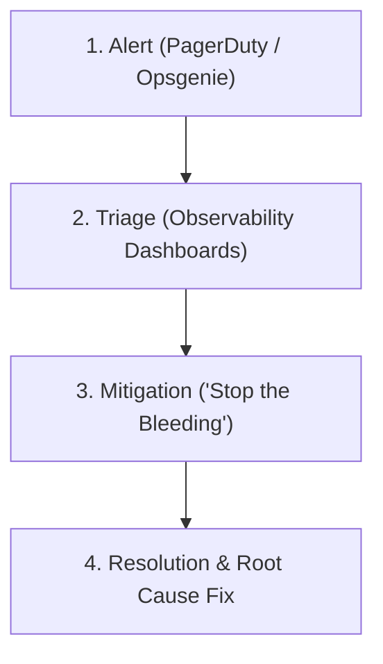
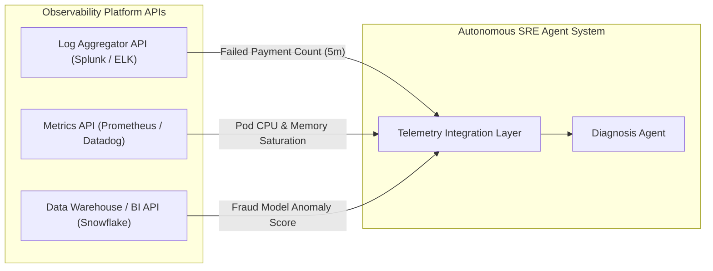
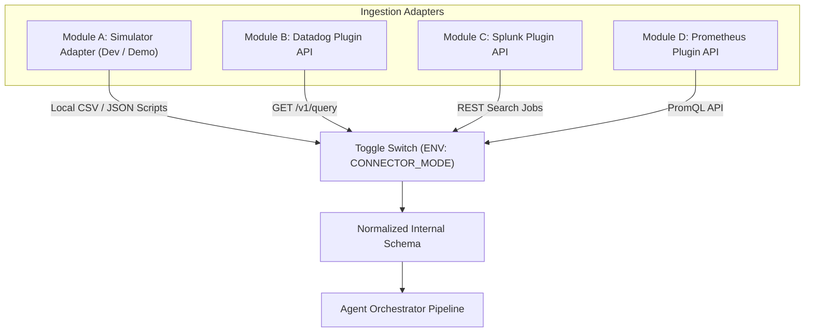
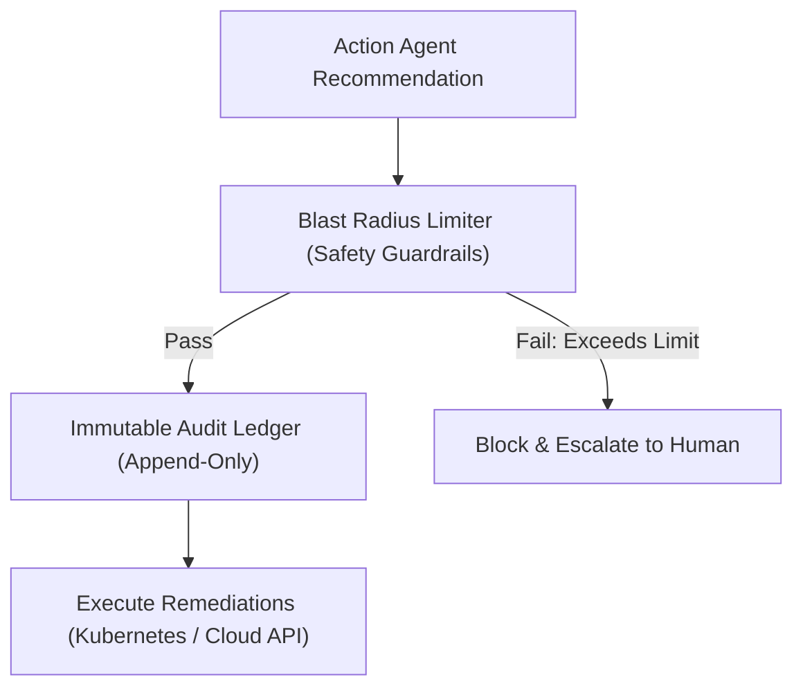

# Strategic Architecture & SRE Advisory Blueprint

This document captures the strategic architectural decisions, SRE operational insights, telemetry connector designs, safety guardrails, and enterprise pitch positioning established from consultations with Senior Site Reliability Engineering (SRE) leadership.

---

## 1. SRE Operational Reality & System Purpose

### 1.1 How SREs Actually Operate
Site Reliability Engineers (SREs) in enterprise tech firms typically balance their workload across two primary domains:
*   **Operations (~50%):** On-call rotation, responding to active outages, mitigating incidents, and conducting post-mortems.
*   **Engineering (~50%):** Writing software and building automation to eliminate toil and prevent future incidents.

### 1.2 What SREs Monitor
SREs rarely inspect raw, unparsed log streams or raw metric tables directly during an incident. Instead, they rely on **Service Level Indicators (SLIs)** derived from the **Four Golden Signals**:
1.  **Latency:** The time it takes to service a request (e.g., successful vs. failed request latency).
2.  **Traffic:** The demand placed on the system (e.g., HTTP requests/sec, transaction rate).
3.  **Errors:** The rate of requests that fail (e.g., HTTP 5xx responses, failed payment authorizations).
4.  **Saturation:** How "full" the service or underlying infrastructure is (e.g., CPU, memory, database connection pool limits).

### 1.3 Standard SRE Incident Workflow


1.  **Alert:** An incident management tool (e.g., PagerDuty) wakes up the on-call engineer when an SLI crosses a critical threshold (e.g., Error Rate > 1%).
2.  **Triage:** SREs inspect centralized observability dashboards to isolate the failure domain (API layer, Database, Dependency, or Network).
3.  **Mitigation:** SREs execute rapid "stop the bleeding" actions (e.g., rolling back a bad deployment, draining traffic from a degraded region, restarting crashed pods).
4.  **Resolution:** SREs investigate root cause, deploy a permanent fix, and write a post-mortem.

### 1.4 How the Autonomous Agent System Helps
The Autonomous Agentic SRE system automates **Steps 2 (Triage)** and **3 (Mitigation)**:
*   **Diagnosis Agent:** Performs multi-perspective root cause analysis (RCA) in seconds.
*   **Action Agent:** Executes **Tier 1 Auto-fixes** (e.g., pod restarts, cache clearing, traffic rerouting), directly eliminating manual repetitive toil.

---

## 2. Telemetry Ingestion Strategy: Raw Data vs. Tool APIs

### 2.1 Architectural Decision: Fetch via Tool APIs
Rather than building raw consumers for streaming platforms (e.g., direct Kafka consumers or raw log tailing), Layer 1 is designed to consume telemetry through the **APIs of existing Observability Platforms** (e.g., Datadog, Splunk, Prometheus, ELK).

### 2.2 Ingestion Option Comparison

| Feature | Option A: Direct Raw Data Ingestion | Option B: Tool API Ingestion (Adopted) |
| :--- | :--- | :--- |
| **Data Quality** | **Low.** Noisy, unstructured raw text; requires complex custom parsers in Layer 2. | **High.** Pre-cleaned, parsed, and structured by enterprise observability tools. |
| **Context** | **Zero.** Log lines lack historical trend context (e.g., missing 30-day baseline comparison). | **Rich.** Provides anomaly scores, standard deviations, and baseline trends directly. |
| **Maintenance** | **High.** Ingestion breaks whenever service log schemas or formats change. | **Low.** Stable REST/GraphQL APIs abstract vendor and application schema changes. |
| **Latency** | **Real-Time.** Sub-second streaming (primarily needed for high-frequency trading). | **Near Real-Time.** 2–5 second delay; fully acceptable for SRE incident remediation. |

### 2.3 Concrete Integration Guidelines



1.  **Payment & Application Logs:** Query Log Aggregator APIs (Splunk/ELK).
    *   *Example Query:* "Count of failed transactions in the last 5 minutes grouped by error code."
2.  **Infrastructure & Container Metrics:** Query Metrics APIs (Prometheus/Datadog).
    *   *Example Query:* "What is the CPU and Memory saturation of `payment-service-prod` pods?"
3.  **Business & Fraud Signals:** Query Data Warehouse APIs (Snowflake) or Model Serving endpoints.
    *   *Example Query:* "Retrieve the 15-minute rolling anomaly score for transaction risk."

---

## 3. The Universal Telemetry Adapter Architecture

### 3.1 Overview & "Observability Pipeline" Pattern
To support both local simulated demonstrations and seamless production enterprise deployments, the Telemetry Integration Layer uses a **Universal Adapter Pattern**.

### 3.2 Standard Normalized Internal Schema
All telemetry data—regardless of source—is converted into a unified internal JSON schema before reaching the agent ecosystem:

```json
{
  "timestamp": "2026-10-10T15:00:00Z",
  "entity": "payment-service-prod",
  "environment": "production",
  "signal_type": "metric",
  "metric_name": "transaction_failure_rate",
  "value": 4.85,
  "unit": "percent",
  "baseline_mean": 0.12,
  "deviation_sigma": 3.4,
  "severity": "critical",
  "tags": {
    "cluster": "us-east-1",
    "service": "checkout-api",
    "deployment_version": "v1.2.4"
  }
}
```

### 3.3 Pluggable Adapter Modules



*   **Module A (Simulator Adapter):** Reads local JSON/CSV scenario files or synthetic generators, normalizes them, and forwards them to the agent pipeline.
*   **Module B (Datadog Plugin):** Queries the Datadog API (`/v1/query`), maps metric/log payloads to the internal schema, and forwards them.
*   **Module C (Splunk Plugin):** Executes Splunk REST search queries (`search index=main ...`), normalizes results, and forwards them.
*   **Module D (Prometheus Plugin):** Calls the Prometheus HTTP API (`/api/v1/query_range`), parses PromQL vectors, and forwards them.

### 3.4 Enterprise Selling Advantages: Zero Data Duplication
*   **Zero Storage Overhead:** The agent system operates as an **intelligent overlay**. Telemetry is read on-demand, analyzed in memory, and immediately discarded.
*   **Fast Compliance & Security Approval:** Enterprise security reviews approve the system quickly because sensitive customer PII and raw logs are **never duplicated or stored** in external databases.

---

## 4. Architectural Strengths & Critical Security Guardrails

### 4.1 System Strengths
1.  **Human-in-the-Loop (ChatOps):** Critical remediation actions (Tier 2/3) require human confirmation via Slack interactive buttons before execution.
2.  **Read/Write Agent Separation:** The **Diagnosis Agent** possesses read-only API access (preventing accidental system state mutations during investigation), while only the **Action Agent** holds write execution permissions.
3.  **Reinforcement Learning Feedback Loop:** Closed-loop feedback powered by Vowpal Wabbit contextual bandits continuously refines action selection policy based on MTTR outcomes and human overrides.

### 4.2 Critical FinTech Security & Reliability Additions



#### A. Blast Radius Limiter (Safety Guardrail)
*   **Function:** Enforces safety policies on the Action Agent to prevent cascading failures.
*   **Rules:**
    *   *Max Restarts:* Never restart more than 1 pod/instance simultaneously in a multi-node service cluster.
    *   *Traffic Drain Limits:* Limit region traffic shifts to a maximum of 25% per step.
    *   *Rate Limits:* Enforce a cooldown period between automated remediation attempts on the same service (e.g., max 2 actions per hour).

#### B. Immutable Audit Trail Ledger
*   **Function:** Writes every telemetry input, LLM reasoning chain, diagnostic hypothesis, and executed action to an append-only, tamper-proof audit log.
*   **Compliance Requirement:** Financial regulators demand full transparency into automated decision-making during incidents affecting financial transaction ledgers.

#### C. Synthetic Monitoring Integration
*   **Function:** Integrates synthetic transaction runners ("fake user checkouts") directly into the **Diagnosis Agent**.
*   **Benefit:** Enables proactive incident detection when synthetic user journeys fail, even before real user error rates spike on production metrics.

---

## 5. Story-Based Incident Simulation Scenarios

To demonstrate real-world SRE value during enterprise demos, the simulator generates structured multi-step incident narrative streams:

### Scenario 1: The "Bad Deploy" Outage
1.  **$T = 0$ (Deployment Event):** Service deployment tag updates from `v1.0.0` to `v1.1.0`.
2.  **$T + 1\text{ min}$ (Latency Spike):** `checkout-api` 99th-percentile latency spikes from 180ms to 2,400ms.
3.  **$T + 2\text{ mins}$ (Error Surge):** HTTP 504 Gateway Timeout error rate reaches 6.2%.
4.  **Agent Action:** The Diagnosis Agent correlates the sudden metric degradation with the recent deployment timestamp and recommends an immediate **Tier 1 Automated Rollback** to `v1.0.0`.

### Scenario 2: Database Connection & Resource Lock
1.  **$T = 0$ (Baseline Traffic):** Application traffic remains constant (500 req/sec).
2.  **$T + 1\text{ min}$ (Database Saturation):** PostgreSQL container CPU utilization spikes to 99% and active connection pool reaches max capacity (100/100).
3.  **$T + 2\text{ mins}$ (Transaction Delay):** Payment completion time delays degrade, but application server CPU remains low (< 20%).
4.  **Agent Action:** The Diagnosis Agent identifies that CPU is low on app nodes but saturated on the database, correctly pinpointing a **Database Resource Lock / Slow Query** rather than an application capacity issue.

---

## 6. Enterprise Pitch & Strategic Positioning

### 6.1 The Pitch Formula
> *"We built an **Agentic Observability Overlay** that sits directly on top of your existing Observability Stack. Whether your organization uses Datadog, Prometheus, or Splunk, our Universal Adapters fetch telemetry via lightweight APIs—allowing Autonomous AI SREs to diagnose and mitigate incidents without requiring data ingestion pipelines or storage migration."*

### 6.2 Key Summary Points for Architecture Diagrams

1.  **Layer 1 Renaming:** Label as **Telemetry Integration Layer** (containing pluggable API connectors).
2.  **Vendor API Connectors:** Display explicit connectors for Datadog API, Splunk REST API, Prometheus PromQL API, and the Local Simulator.
3.  **Toggle Connector Switch:** Include a visual mode toggle between `Simulator Mode` (for dev/demo) and `Live Enterprise Platform APIs` (for production).
4.  **Safety Guardrail Layer:** Show the **Blast Radius Limiter** positioned directly between the Action Agent and infrastructure execution targets.
