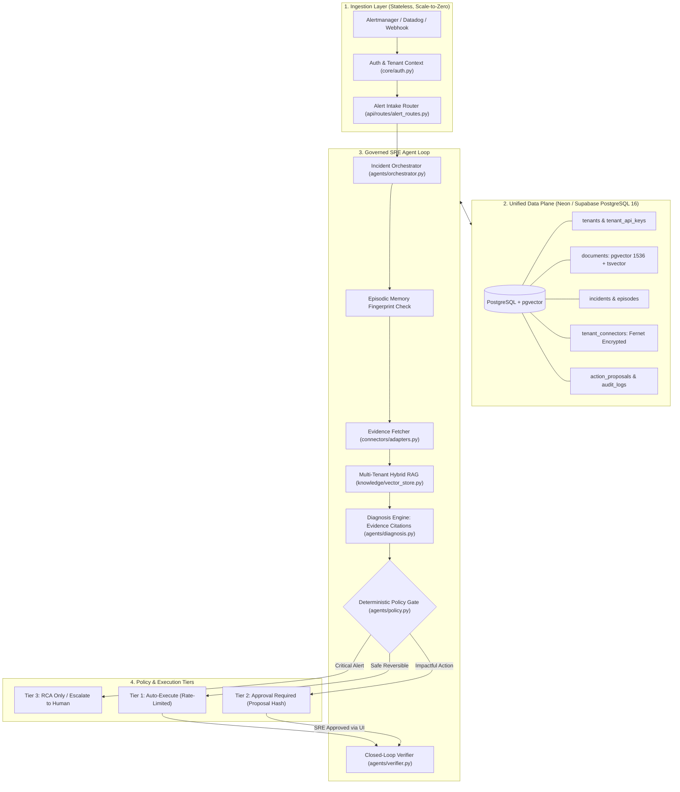

# Architectural Decisions & Engineering Trade-Offs

This document records the foundational architecture decisions, structural trade-offs, and security boundaries chosen for the **Autonomous SRE Intelligence SaaS** platform.

---

## 🏛️ System Architecture Overview

---

## ⚖️ Architectural Decision Records (ADRs)

### 1. Model Serving: Serverless Pay-per-Token vs. Dedicated GPU Instances

* **Context:** The original prototype deployed dedicated vLLM GPU servers on Modal or designed AWS EC2 `g5.xlarge` / `g5.12xlarge` GPU instances.
* **Decision:** Replaced all dedicated GPU servers with **pay-per-token OpenAI-compatible serverless endpoints** (OpenAI `gpt-4o-mini`, OpenRouter `DeepSeek-V3`, or `Gemini 2.0 Flash`) and standard embedding APIs (`text-embedding-3-small`).
* **Alternatives Considered:**
  1. *AWS EC2 GPU Instances (`g5.xlarge`):* Costs ~$730–$1,200/month fixed per instance regardless of traffic. Requires managing NVIDIA drivers, PyTorch/vLLM updates, and requesting high GPU quotas.
  2. *Dedicated Modal Functions:* Pay-per-second, but cold starts take 45–90 seconds and public endpoints require custom egress proxying.
* **Trade-Offs & Rationale:**
  * **Pros:** Fixed cost drops from **$750+/month to $0/month**. Incidents are inherently bursty; pay-per-token aligns COGS directly with revenue. Diagnostic analysis costs **~$0.002 per incident**.
  * **Cons:** Inference relies on commercial API availability. Mitigated by using standard OpenAI-compatible interfaces (`ChatOpenAI`), allowing zero-code provider switching via `.env` (`LLM_BASE_URL`).

---

### 2. Knowledge & Vector Store: `pgvector-scale` (DiskANN) + `pg_textsearch` (BM25)

* **Context:** High-performance incident diagnosis requires both:
  1. *Dense Semantic Search* for conceptual intent (e.g. "traffic spike causing thread starvation").
  2. *Sparse Exact Keyword Search* for precise error codes, exception classes, and status metrics (e.g., `OOMKilled`, `CrashLoopBackOff`, `HTTP 504`, `java.lang.OutOfMemoryError`).
* **Decision:** Implemented a unified hybrid search engine combining **`pgvector-scale` (StreamingDiskANN vector search)** and **`pg_textsearch` (native BM25 relevance ranking)** directly inside PostgreSQL 16:
  * **Semantic Indexing (`pgvector-scale`):** Uses the `USING diskann` access method (`idx_documents_diskann`). Employs Statistical Binary Quantization (SBQ) and disk-backed graph traversal, reducing memory consumption by up to 28x compared to in-memory HNSW while preserving >99% recall.
  * **Keyword Indexing (`pg_textsearch`):** Uses the `USING bm25(content)` access method (`idx_documents_bm25`) with the `<@>` scoring operator. Provides term frequency saturation, document length normalization, and inverse document frequency (IDF) handling without syncing data to external Elasticsearch or OpenSearch clusters.
  * **Fusion:** Combines both legs using **Reciprocal Rank Fusion (RRF)**:
    $$\text{RRF Score} = \frac{1}{60 + \text{Rank}_{\text{DiskANN}}} + \frac{1}{60 + \text{Rank}_{\text{BM25}}}$$
  * **Fallback Guarantee:** If deployed on a standard Postgres instance without these extensions pre-compiled, the schema gracefully falls back to `hnsw`/`ivfflat` and native `tsvector` GIN indexes.
* **Alternatives Considered:**
  1. *Dedicated External Search Clusters (Pinecone + Elasticsearch/OpenSearch):* Requires managing two distributed stateful systems, paying $150+/month baseline, and managing dual-write sync consistency.
  2. *Naive PostgreSQL Full-Text Search (`tsvector` / `ts_rank`):* Lacks term frequency saturation (repeating a keyword 50 times inflates score artificially) and document length normalization, leading to degraded runbook ranking compared to BM25.
* **Trade-Offs & Rationale:**
  * **Pros:** Industry-standard BM25 and DiskANN performance inside a single PostgreSQL connection. Multi-tenant isolation (`WHERE tenant_id = $1`) is applied atomically within the same SQL query plan.
  * **Cons:** Requires installing the `pg_textsearch` and `vectorscale` extensions if hosting your own PostgreSQL container, though our schema includes automated fallbacks for managed vanilla databases.

---

### 3. Autonomy Governance: Deterministic Policy Gate vs. Autonomous Model Agency (ReAct)

* **Context:** Autonomous agents given free-form bash or API tool-calling capabilities often suffer from catastrophic hallucination, infinite retry loops, and unbounded blast radiuses during high-stress production outages.
* **Decision:** Enforced a **rigid, deterministic Python policy gate** (`DeterministicPolicyGate` in [`agents/policy.py`](file:///d:/Downloads/projects/autonomous_anomaly_resposne_agent/fully_deployed_saas/agents/policy.py)). The LLM only *proposes* hypotheses; it **never** directly triggers infrastructure execution.
* **Safety Rules Enforced:**
  1. **Critical Severity Rule:** Any incident classified as `CRITICAL` is unconditionally restricted to **Root-Cause Analysis (RCA) only**. Automated actions are mathematically blocked by the gate.
  2. **Three-Tier Action Hierarchy:**
     * **Tier 1 (Auto):** Only allowlisted, idempotent, and reversible actions (`restart_unhealthy_pod`, `scale_replicas`, `clear_cache`).
     * **Tier 2 (Approval Required):** High-impact actions require an explicit human SRE approval click in the Command Center.
     * **Tier 3 (Human Only):** Persistent failures or database failovers default to human investigation.
  3. **Circuit Breaker:** Rate-limited to a maximum of 5 actions per target service per hour to prevent cascading oscillation loops.
* **Trade-Offs & Rationale:**
  * **Pros:** Guaranteed zero-blast-radius protection. Eliminates the risk of an LLM issuing `rm -rf`, `DROP TABLE`, or rebooting critical database clusters.
  * **Cons:** Less flexible than unconstrained agents. Even if an auto-fix is obvious for a critical alert, human approval is mandatory. We accept this constraint because enterprise SRE teams reject non-deterministic production mutation.

---

### 4. Action Integrity: Cryptographic Proposal Hashing

* **Context:** In human-in-the-loop workflows, an action proposed at $T_0$ might be approved at $T_{10}$. If incident state changes or malicious payloads are injected between proposal and execution, unauthorized actions could run.
* **Decision:** Implemented **SHA-256 Proposal Hash Binding** ([`core/security.py`](file:///d:/Downloads/projects/autonomous_anomaly_resposne_agent/fully_deployed_saas/core/security.py)):
  $$\text{hash} = \text{SHA256}(\text{incident\_id} + \text{action\_type} + \text{target\_service} + \text{canonical\_parameters})$$
* **Trade-Offs & Rationale:**
  * **Pros:** When an SRE approves an action in the UI, the backend validates that the database proposal hash exactly matches the execution request. Any modification of action parameters invalidates the approval.
  * **Cons:** SREs cannot edit action parameters inline during approval; modifying parameters requires issuing a new proposal.

---

### 5. Multi-Tenancy Architecture: Logical Partitioning vs. Database-per-Tenant

* **Context:** Building a SaaS product requires isolating customer telemetry, incident data, and runbooks.
* **Decision:** Implemented **logical row-level multi-tenancy** partitioned by `tenant_id` on all tables, with foreign-key cascades and scoped database indexes.
* **Alternatives Considered:**
  1. *Database-per-Tenant:* Creates an isolated PostgreSQL database for every customer. High operational complexity, slow migrations, and requires expensive multi-database connection poolers.
  2. *Schema-per-Tenant:* Creates a separate PostgreSQL schema per customer. Increases migration complexity and connection overhead.
* **Trade-Offs & Rationale:**
  * **Pros:** Extreme cost efficiency (one database supports hundreds of organizations). Connection pooling is shared across tenants.
  * **Cons:** Relies on application-layer discipline to ensure every query filters by `tenant_id`. Mitigated by encapsulating all database access behind classes that require `tenant_id` at instantiation (`MultiTenantRAG`, `TenantConnectorManager`, `IncidentOrchestrator`).

---

### 6. Secrets Management: Application-Level Fernet AES vs. Cloud KMS

* **Context:** Customer telemetry credentials (Prometheus tokens, Datadog API/App keys) must be stored securely.
* **Decision:** Implemented **AES-128-CBC with SHA-256 HMAC (Fernet)** symmetric encryption at the application layer, using a master secret injected via environment variable (`ENCRYPTION_MASTER_KEY`).
* **Alternatives Considered:**
  1. *AWS Secrets Manager / Google Secret Manager:* Stores credentials as cloud secrets. Incurs cloud provider lock-in and costs $0.40/secret/month, which scales poorly with hundreds of customer connectors.
  2. *Plaintext JSON files (previous repo design):* Unacceptable for SaaS production.
* **Trade-Offs & Rationale:**
  * **Pros:** Cloud-agnostic (runs on Render, Fly.io, Cloud Run, or on-prem). Zero per-secret cloud API costs.
  * **Cons:** Key rotation requires a database re-encryption script. The master encryption key must be protected in your hosting platform's environment settings.

---

### 7. Evidence Citations & Algorithmic Confidence Capping

* **Context:** LLMs frequently hallucinate confidence (e.g., claiming 0.95 confidence on fabricated root causes).
* **Decision:** Enforced a **strict citation resolution engine** ([`agents/diagnosis.py`](file:///d:/Downloads/projects/autonomous_anomaly_resposne_agent/fully_deployed_saas/agents/diagnosis.py)):
  * Every telemetry record is assigned an immutable citation identifier ($E_1, E_2, E_3$).
  * The diagnosis engine verifies every citation in the LLM's hypothesis against real records.
  * If citations are fabricated or absent, **confidence is algorithmically capped at $\le 0.40$**.
  * If only a single piece of evidence is cited, **confidence is capped at $\le 0.70$**.
* **Trade-Offs & Rationale:**
  * **Pros:** Prevents ungrounded hallucinations from escalating to high-confidence incidents.
  * **Cons:** Conservative scoring; complex multi-factor incidents with sparse telemetry may receive lower confidence scores than they intuitively warrant.

---

### 8. Closed-Loop Verification: Active Metric Re-Reading

* **Context:** Many automated remediation tools assume that executing an action (e.g. `kubectl rollout restart`) means the incident is resolved. In reality, memory leaks or deadlock loops often persist.
* **Decision:** Implemented an independent **Closed-Loop Verifier** ([`agents/verifier.py`](file:///d:/Downloads/projects/autonomous_anomaly_resposne_agent/fully_deployed_saas/agents/verifier.py)) that actively queries telemetry after a stabilization window.
* **Outcomes:**
  * `RECOVERED`: All anomalous metric thresholds normalized.
  * `NOT_RECOVERED`: Anomaly indicators persist. Incident is immediately re-opened and escalated.
  * `INCONCLUSIVE`: Telemetry unavailable or adapter error. Fails closed to escalation.
* **Trade-Offs & Rationale:**
  * **Pros:** Guarantees that incidents are marked resolved only when verified by real telemetry data.
  * **Cons:** Adds a 2–30 second stabilization wait before final incident close-out.

---

## 📊 Cost Scaling & Economics

| Stage | Active Tenants | Monthly Incidents | Hosting (Compute + DB) | LLM Tokens Cost | Total COGS / Mo |
| :--- | :--- | :--- | :--- | :--- | :--- |
| **Launch / Pilot** | 1 – 5 | 100 – 500 | $0.00 (Neon Free + Cloud Run Free) | ~$0.50 | **<$1.00 / mo** |
| **Early Growth** | 10 – 50 | 2,000 – 5,000 | $7.00 – $19.00 (Render or Neon Scale) | ~$5.00 – $10.00 | **~$15 – $29 / mo** |
| **Scale** | 100 – 500 | 50,000 | $50.00 – $100.00 (Managed DB + Containers) | ~$100.00 | **~$150 – $200 / mo** |

At a standard SaaS pricing tier of **$49 – $199 / organization / month**, the gross profit margin remains **above 92–95%**.
